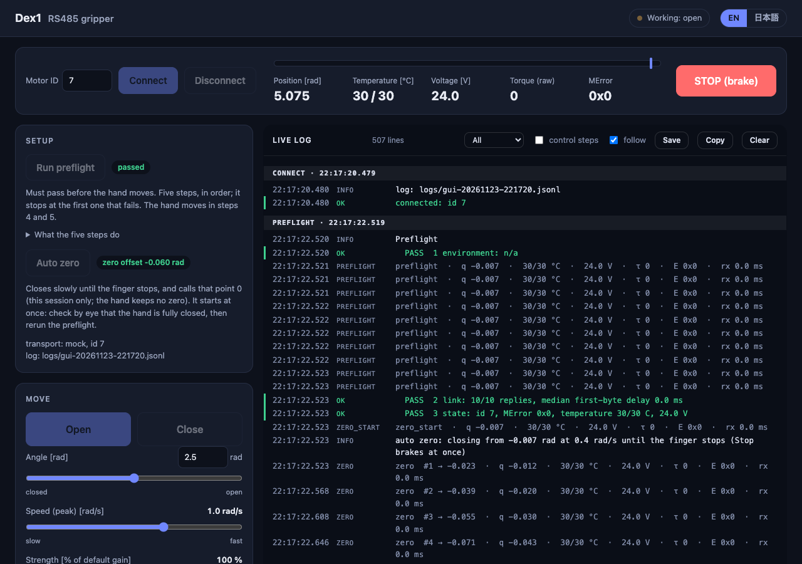

# dex1-console

[](https://github.com/masayuki-kobayashi-aicle/dex1-console/actions/workflows/ci.yml)

Drive a Unitree **Dex1-1** gripper over RS485 from a laptop with an **ESP-Prog** (FT2232H) and a **MAX3485** board.
No expansion box and no vendor SDK are needed. Zero runtime dependencies for the protocol and the mock; `pyftdi` and
`pyserial` only for the real adapter.

The repository is `dex1-console`; the Python package is `dex1-rs485` and the command is `dex1`.

> **Not affiliated with Unitree.** The frame layout follows Unitree's public SDK (BSD 3-Clause, see [NOTICE](NOTICE)).
> Driving the hand without Unitree's own expansion box is an unofficial method and may void its warranty.
> Use at your own risk: the hand is a powerful actuator. Read [docs/safety.md](docs/safety.md) before the first move.



*Screenshot of `dex1 gui --transport mock`: a simulated hand, no hardware connected.*

## Status

Measured on **one right hand (id 7)**, 6 Mbaud, on a Linux host and on a Mac (full stroke on both).
Unverified: the left hand, other ids, long runs and thermal behaviour (see [docs/wiring.md](docs/wiring.md)). The default safety limits come from that one hand.

## Install

```sh
git clone https://github.com/masayuki-kobayashi-aicle/dex1-console.git
cd dex1-console
pip install -e ".[espprog]"          # real adapter (pyftdi, pyserial)
pip install -e ".[espprog,rerun]"    # plus Rerun export
pip install -e ".[dev]"              # tests
```

macOS needs libusb (`brew install libusb`). Linux needs permission for the USB device (udev rule or sudo).

## Quick start

Wire the adapter first ([docs/wiring.md](docs/wiring.md)), then:

```sh
dex1 selftest                 # protocol check against vendor SDK frames; sends nothing
dex1 probe                    # read-only: does the hand answer?
dex1 preflight                # link, state, calibration (it closes itself; you check by eye), a small test motion
dex1 console                  # interactive: Enter toggles open/close, `h` for help
dex1 gui                      # web GUI on 127.0.0.1: buttons, live log view
dex1 move --to 2.5            # one move to an absolute angle [rad]
dex1 cycle --cycles 3         # open/close repeatedly
dex1 export-rerun LOG.jsonl --label "dex1 demo" -o demo.rrd [--video clip.mp4 --video-offset-s 3.2]
```

Try everything without hardware: add `--transport mock`.

Messages are in English or Japanese: `--lang ja` (or `lang = "ja"` in the config, or `DEX1_LANG=ja`). The default `auto` follows the
locale. Logs and `--help` stay in English.

Console commands: `Enter` toggle, `o` open, `c` close, `g <rad>`, `s` status, `t <s>` move time, `l on|off` log,
`p` preflight, `z` auto zero, `b` brake, `h` help, `q` quit. Ctrl-C during a move brakes. Any anomaly (3 missed replies in a row,
over temperature, tracking error, MError) brakes automatically.

The GUI (`dex1 gui`, add `--no-open` to keep the browser closed, `--port N`; English or Japanese with the EN / 日本語 switch)
has connect (with a motor id 0-15), preflight, open / close, a position slider, a speed slider, a strength slider, STOP and
auto zero. It shows the hand's position, temperature, voltage and raw torque, and every exchange as it happens, in a log that is
grouped by job, colour-coded, filterable, and can be saved to a text file. It needs no extra packages.

- *Speed* is the peak speed of the cosine ramp in rad/s; the move time follows from the distance. A peak above
  `max_speed_rad_s` (1.5) is refused, and a very short move is never faster than `min_ramp_s`.
- *Strength* is the position gain as a percentage of the default (`kp_raw`), 10-100 %. **It is not a calibrated torque.** A
  soft hand may lag the command and trip the tracking-error stop.
- *Auto zero* closes the finger slowly until it stops moving (position only; no current is read) and calls that point 0. The
  offset lives in the session only: it is not written to the hand and is gone when you disconnect. It starts without a question (look at the hand
  afterwards), and moves wait for a new preflight. **Its parameters are choices, not measurements, and it has not run on a real hand.**

The GUI listens on `127.0.0.1` only (there is no option for other addresses), checks the Host header, and requires a
per-run token on every command, so a web page you happen to have open cannot move the hand. The buttons that move the hand stay
disabled until the preflight has passed (`--skip-preflight` lifts that). `Esc` or the red button stops a move and brakes.
Try it without hardware: `dex1 gui --transport mock`.

Logs are JSONL in `~/.local/share/dex1-rs485/logs` (change with `--log-dir`, disable with `--no-log`).
Known issue: `dex1 gui` accepts `--no-log` but ignores it and always writes a log; use `--log-dir` to choose where.
Configuration: [examples/dex1.toml](examples/dex1.toml), passed with `--config`. Unknown keys are rejected.

## License

Apache-2.0 ([LICENSE](LICENSE)). Attribution to Unitree's SDK is in [NOTICE](NOTICE).

## Documents

- [docs/wiring.md](docs/wiring.md): pins, MAX3485 naming, DTR/RTS, macOS notes
- [docs/protocol.md](docs/protocol.md): frames, CRC, scaling
- [docs/safety.md](docs/safety.md): limits, what was measured, what was not
